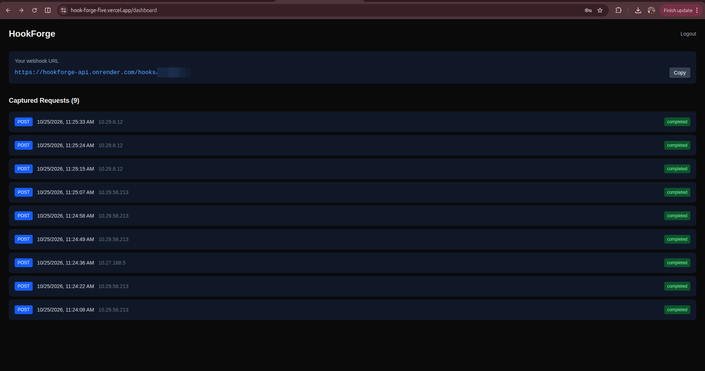
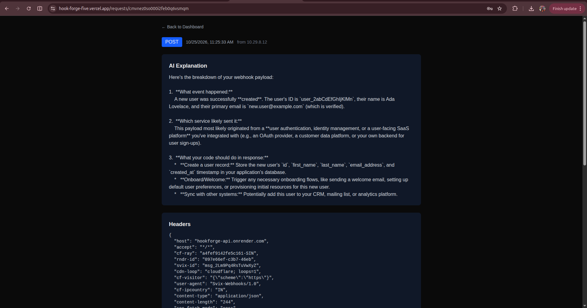
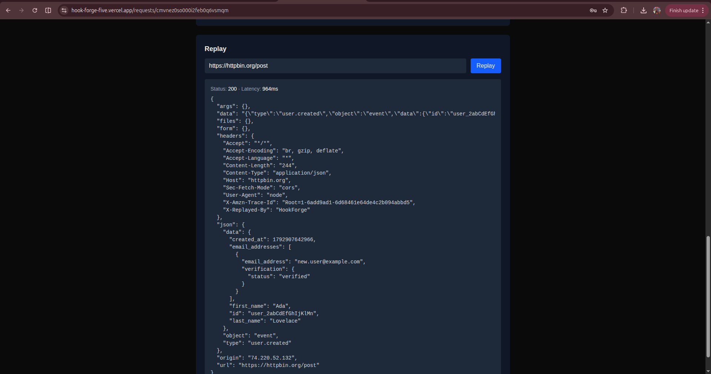

# HookForge

A webhook inspection, replay, and AI explanation platform for developers.

**🔗 Live demo: https://hook-forge-five.vercel.app**

> Demo login — email: `demotest@hookforge.dev` · password: `WingardiumLaviosa`
> Hosted on free tiers, so the first request after a quiet period can take up to a minute while the API wakes up.



## The Problem

Testing webhooks locally is painful:
- **No persistent URL** — ngrok gives a temporary URL that dies on every restart
- **No history** — close the terminal, lose everything
- **No replay** — if your server had a bug when the webhook arrived, that event is gone forever
- **Raw JSON is confusing** — developers don't know what a payload means or what to do with it

## The Solution

Every user gets a permanent public URL on signup. Paste it into Stripe, GitHub, or any service once — and never change it again.

From that moment:
- Every webhook is **captured and stored permanently**
- The dashboard **updates in real time** via Server-Sent Events
- Each request gets an **AI explanation** in plain English
- Any past request can be **replayed** to a public target URL, showing status, latency, and the response
- Your full request history stays in one dashboard

## Architecture

```
Client (Next.js)
└── Dashboard, request inspector, replay UI
└── Holds SSE connection open for real-time updates

    ↕ HTTP / SSE

Express API
└── Auth, dashboard API, SSE endpoint, webhook capture
└── POST /hooks/:slug — public webhook receiver

    ↕ reads/writes

PostgreSQL + Prisma
└── Users, endpoints (slugs), captured requests, AI explanations

    ↕ enqueues jobs

BullMQ + Redis
└── Job queue for AI explanation jobs

    ↕ picks up jobs

Worker Process
└── Calls Gemini API, saves explanation, pushes SSE update
```

## Tech Stack

| Layer | Technology | Why |
|---|---|---|
| Frontend | Next.js | App Router, SSR, Tailwind |
| Backend | Express.js | Familiar, industry standard |
| Database | PostgreSQL + Prisma | Relational data, type-safe queries |
| Queue | BullMQ + Redis | Best job queue for Node.js, automatic retries |
| Real-time | Server-Sent Events | Data only flows server→client, simpler than WebSockets |
| AI | Google Gemini API | Free tier for development |
| Auth | JWT access + refresh tokens + bcrypt | Industry standard pattern |
| Containerization | Docker + docker-compose | One command runs everything |

## Key Engineering Decisions

**Why SSE instead of WebSockets?**
Data only flows one direction — server to browser. SSE is simpler, built into browsers natively. WebSockets would be unnecessary complexity.

**Why BullMQ for AI calls?**
Gemini API takes 2-5 seconds and can fail. Stripe expects a response in milliseconds. BullMQ decouples the slow AI work from the fast webhook capture path. If the AI call fails, BullMQ retries automatically with exponential backoff.

**Why monorepo?**
API and Worker share the same Prisma schema. Monorepo lets them share `packages/db` without duplication.

**Why store rawBody separately?**
Stripe signs the raw request body for signature verification. Parsing JSON first changes the bytes and breaks verification. Raw body must be stored exactly as received.

**Why nanoid for slugs?**
URL-safe, random, short (8 chars), statistically impossible to guess. Better than UUIDs in a URL.

## Security Notes

- Passwords hashed with bcrypt; short-lived JWT access tokens plus refresh tokens
- **Replay SSRF protection** — replay targets must be public `http(s)` URLs; loopback, private, link-local, and cloud-metadata addresses are rejected, redirects are not followed, and requests time out after 10 seconds
- Per-IP rate limiting on `/auth` and `/hooks`, JSON body size limit, and AI prompts capped at 8,000 characters
- The worker → API endpoint requires a shared secret
- CORS restricted to an allow-list of origins from an environment variable

## Running Locally

### Prerequisites
- Docker and Docker Compose
- Gemini API key (free at [aistudio.google.com](https://aistudio.google.com))

### Setup

1. Clone the repo
```bash
git clone https://github.com/Rishi-Ra-1j/HookForge.git
cd HookForge
```

2. Create a `.env` file at the root:
```
GEMINI_API_KEY=your_gemini_api_key_here
```

3. Start everything:
```bash
docker compose up --build
```

4. Run database migrations:
```bash
docker compose exec -w /app/packages/db api npx prisma migrate deploy
```

5. Open `http://localhost:3000`

That's it. One command starts PostgreSQL, Redis, API, Worker, and the frontend. (If a port is already in use on your machine, change the left-hand number of that port mapping in `docker-compose.yml`.)

### Load demo data

Register an account, copy your webhook URL from the dashboard, then:
```bash
node scripts/seed-demo.mjs <your-webhook-url>
```
This sends nine realistic sample webhooks (Stripe, GitHub, Razorpay, Shopify, Vercel, SendGrid, Clerk) so the dashboard isn't empty. The hosted demo only replays to public URLs; `docker-compose.yml` sets `ALLOW_PRIVATE_REPLAY=true` for local development so you can replay to private addresses too.

## Deployment

| Part | Where | Notes |
|---|---|---|
| Frontend | Vercel | Root directory `apps/web`; `NEXT_PUBLIC_API_URL` must be set before the build |
| API + worker | Render (Docker, `Dockerfile.render`) | Runs migrations on start, then API and worker in one process |
| Postgres | Neon | Direct connection string |
| Redis | Render Key Value | `noeviction` policy, internal URL |

See `.env.example` for the environment variables each service needs.

## Project Structure

```
HookForge/
  apps/
    api/      → Express server (auth, REST API, SSE, webhook capture)
    worker/   → BullMQ worker (picks jobs, calls Gemini, saves explanations)
    web/      → Next.js frontend (dashboard, inspector, replay UI)
  packages/
    db/       → Prisma schema + client (shared between api and worker)
    queue/    → BullMQ queue setup (shared between api and worker)
  scripts/    → seed-demo.mjs (sample webhooks for demos)
  docker-compose.yml
  Dockerfile.render
```

## API Routes

### Auth
- `POST /auth/register` — create account, auto-generate slug, return tokens
- `POST /auth/login` — return access + refresh tokens
- `POST /auth/refresh` — exchange refresh token for new access token
- `GET /auth/me` — get current user + webhook URL

### Requests (JWT protected)
- `GET /requests` — paginated list of captured requests
- `GET /requests/:id` — full request detail with headers, body, explanation
- `POST /requests/:id/replay` — replay stored request to a target URL

### Webhook Capture (public)
- `POST /hooks/:slug` — receives incoming webhooks, saves to DB, enqueues AI job

### Real-time
- `GET /sse?token=<jwt>` — SSE endpoint, pushes events to dashboard
